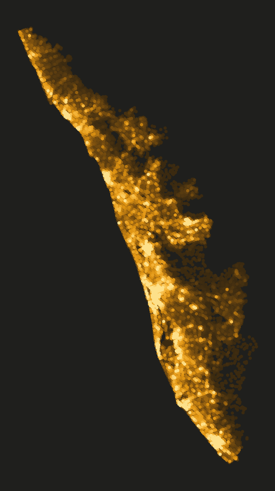
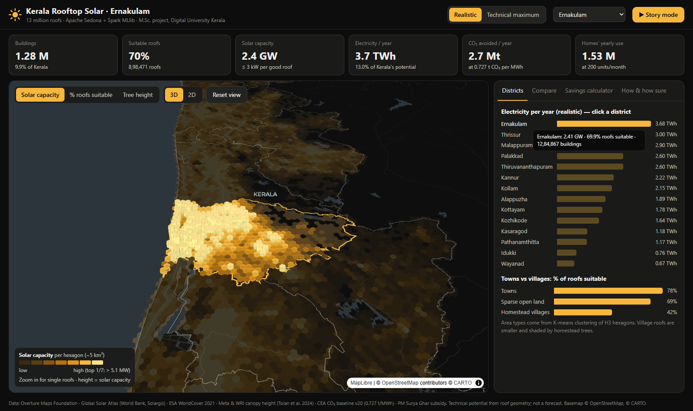
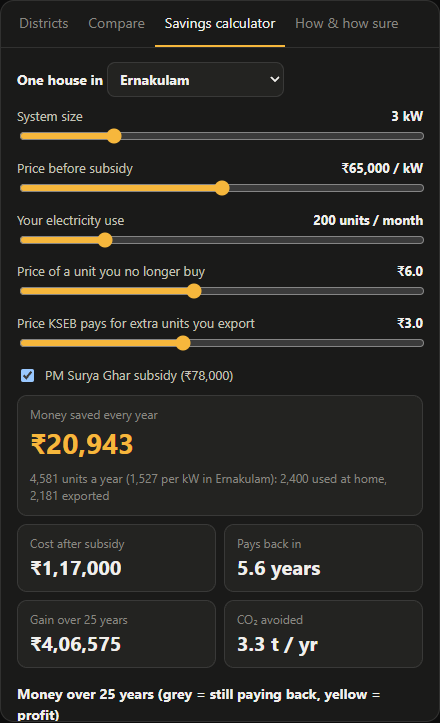
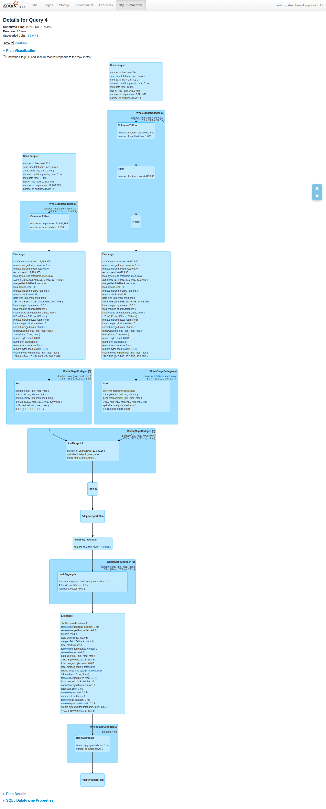

<div align="center">

# ☀️ Rooftop Solar Potential of Kerala

**Spatial big data with Apache Sedona and Spark MLlib: 12.99 million buildings, every roof judged for solar.**

[](https://muhammedshahidsds25-collab.github.io/kerala-rooftop-solar/dashboard/web/)
[](report/Rooftop_Solar_Kerala_Project_Report.pdf)
[](presentation/Rooftop_Solar_Kerala_Final.pptx)




M.Sc. Data Science & Geoinformatics, Digital University Kerala · Spatial Bigdata Analytics (M5221357)
<br>Author: **Muhammed Shahid S**

</div>

---

How much electricity could Kerala's rooftops produce? This project maps **12.99 million buildings**, judges every
roof for solar with a machine-learning model, and measures each suitable roof's free area, all with spatial
big-data tools (Apache Sedona, Spark, PostGIS) on Google Colab.

## Results at a glance

| | Value |
|---|---|
| 🏠 Buildings mapped (inside Kerala, after cleaning) | 12,989,365 |
| ✅ Roofs suitable for solar (Random Forest) | 6,692,930 (51.5%) |
| ⚡ **Realistic potential** (each suitable roof installs its free area, at most 3 kW) | **18.5 GW · 28.2 TWh/yr** (about 88% of Kerala's yearly need of ~32 TWh) |
| 📈 Technical maximum (all free roof area, 0.6 m edge and 8 m² stair room removed) | 64.3 GW · 98.1 TWh/yr (range 51–78 GW) |
| 🌱 CO₂ avoided, realistic case (0.727 t CO₂/MWh, CEA) | ~20.5 Mt per year |
| 🔌 Installed rooftop solar in Kerala today (Oct 2024) | ~0.95 GW |

Towns have far more suitable roofs (78%) than tree-shaded homestead villages (42%). Ernakulam, Thrissur and
Malappuram have the largest potential; Wayanad the smallest. These are technical potentials from roof geometry,
not a forecast.

## 🗺️ Interactive dashboard

**[Open the live dashboard →](https://muhammedshahidsds25-collab.github.io/kerala-rooftop-solar/dashboard/web/)**

<p align="center">
  
  
</p>

- a 3D hexagon map (deck.gl)
- district ranking and comparison
- a household savings and payback calculator (PM Surya Ghar subsidy)
- a 6-step story mode

To run it locally, open [`dashboard/web/index.html`](dashboard/web/index.html) in a browser (internet needed
for the map). To rebuild its data: `python dashboard/web/build_data.py`. A simpler Streamlit version is in
[`dashboard/app.py`](dashboard/app.py) (`streamlit run dashboard/app.py`).

## 📄 Report and slides

- Final report: [`report/Rooftop_Solar_Kerala_Project_Report.pdf`](report/Rooftop_Solar_Kerala_Project_Report.pdf)
- Final presentation (20 slides): [`presentation/Rooftop_Solar_Kerala_Final.pptx`](presentation/Rooftop_Solar_Kerala_Final.pptx)

<p align="center">
  
  <br><em>Spark SQL plan of the main dashboard query</em>
</p>

## Method

```
Overture buildings (19.4 M) ──► Sedona: district join + cleaning ──► 13.0 M roofs
        │                                                              │
        ▼                                                              ▼
Global Solar Atlas · ESA WorldCover · Meta 1 m canopy height ──► roof features (size, shape, sun, trees, crowding)
        │                                                              │
        ├──► PostGIS (GiST index, partitioning)    ├──► K-means on H3 hexagons, FP-Growth rules
        ▼                                                              ▼
290 labelled roofs (human + AI, blind check) ──► Spark MLlib Random Forest ──► suitable / not suitable for all roofs
                                                                       │
                                                                       ▼
                                          Sedona ST_Buffer: free roof area ──► potential per roof, hexagon, district
```

| Notebook | What it does |
|---|---|
| [01](notebooks/01_download_data.ipynb) | Download Overture Maps buildings and district boundaries (DuckDB) |
| [02](notebooks/02_sedona_clean_join.ipynb) | Sedona spatial join to districts, cleaning, Spark vs Sedona timing, MapReduce |
| [03](notebooks/03_roof_features.ipynb) | Sunlight (Global Solar Atlas), tree cover (ESA WorldCover), shape, H3 crowding |
| [04](notebooks/04_label_sample.ipynb) | Random sample of 300 roofs for labelling |
| [05](notebooks/05_tree_features.ipynb) | Faster neighbourhood tree features with NumPy (6.4 h → 42 s) |
| [06](notebooks/06_postgis.ipynb) | PostGIS: GiST index (~450× faster), LIST partitioning (~10×) |
| [07](notebooks/07_kmeans_fpgrowth.ipynb) | K-means area types on H3 hexagons, FP-Growth association rules |
| [08](notebooks/08_random_forest.ipynb) | Random Forest with leave-one-district-out validation |
| [09](notebooks/09_canopy_height.ipynb) | Meta / WRI 1 m canopy height around every roof (~82 billion pixels) |
| [10](notebooks/10_random_forest_final.ipynb) | Final model on gold labels; predictions for all roofs |
| [11](notebooks/11_usable_roof_area.ipynb) | Free roof area per roof with Sedona `ST_Buffer`, sensitivity analysis |
| [12](notebooks/12_dashboard_data.ipynb) | Small summary files for the dashboard |

`tools/` holds the QGIS labelling helpers and an AI (Gemini) second labeller; `report/method_notes.md` has the
methods, limitations and data volume; `report/figures/` holds Spark UI screenshots.

All heavy notebooks run on Google Colab (Spark 4.1.3 local mode, Apache Sedona 1.9.1, 2 cores, ~13 GB RAM).
They read and write `MyDrive/rooftop_solar/` on Google Drive; the large data (~14 GB) is not in this repository.

## Model accuracy and limits

- Leave-one-district-out accuracy **0.68** (ROC AUC 0.72), against 0.54 for always answering "good".
- Labels: 300 random roofs judged on satellite imagery by the author and by an AI vision model (Google Gemini);
  218 agreed, and the disagreements were re-judged blind by the author (72 decided). The tie-break may lean
  towards the author's view.
- Imagery dates differ (buildings ~2022–23, canopy ~2018–20, labelling imagery ~2025). Partial shading, roof
  material, structure, grid and ownership limits are not modelled. See `report/method_notes.md` for details.

## Data sources and credits

Overture Maps Foundation (buildings and divisions; ODbL / CDLA Permissive) · Global Solar Atlas 2.0
(© World Bank, Solargis; CC BY 4.0) · ESA WorldCover 2021 (CC BY 4.0) · Meta & WRI global canopy height map
(Tolan et al. 2024; CC BY 4.0) · CEA CO₂ Baseline Database · Esri World Imagery (labelling only) ·
Basemap © OpenStreetMap contributors, © CARTO. Derived building data in this repository keep the licences of
their sources.
